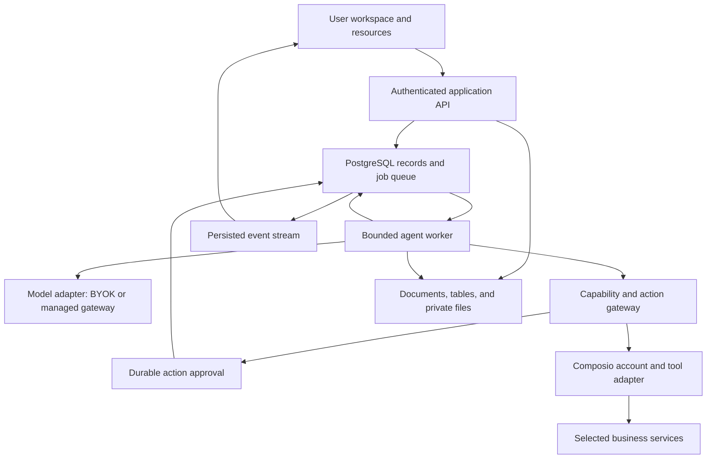

# Bootstrap technical design

Version: 0.3 proposal, revised around a user workspace, persistent agents, and paid managed instances. All stack choices and limits below are implementation recommendations. No live service has been provisioned by this specification change.

## 1. Architecture

Use a TypeScript monorepo with a web application and a separate long-lived worker. PostgreSQL stores projects, documents, structured tables, manual tasks, agent state, and the job queue. Ordinary workspace editing requires no model call. Assigning work to an agent creates a durable task and execution thread; the worker executes it independently of a browser connection.

The same application runs standalone or as one managed instance per subscriber. A hosted account can own multiple workspaces within that instance. The hosted control plane manages payment, provisioning, credits, and managed provider gateways; its lifecycle and accounting contract is in [hosted service](hosted-service.md). Agent identity, six resource areas, mailbox delivery, and task ownership follow the original design in [agent architecture](agent-architecture.md), informed by Openbot's public architecture.

The application gateway is the only execution path for tools. Internal tools also use authorization and structured validation. Provider-managed tool execution must not bypass the gateway.

### Proposed stack

| Layer | Choice | Purpose and boundary |
| --- | --- | --- |
| Web | Next.js, React, TypeScript | Founder application and authenticated API; deployable as a Node container |
| UI | Selected AffectUI/BeUI source, Tailwind, Bootstrap wrappers | Shared tokens and controlled product components |
| Model interface | Vercel AI SDK | Streaming, structured outputs, provider adapters; Bootstrap owns durable steps and policy |
| Database | PostgreSQL with Drizzle migrations | Tenant-scoped records, concurrency control, full-text retrieval |
| Durable jobs | pg-boss | Postgres-backed scheduling, retries, and workers; action ledger still required |
| Authentication | Better Auth with database-backed sessions | Initial owner authentication; signup closed after owner bootstrap in self-host mode |
| Integrations | Composio server SDK behind an adapter | Connections, scoped tool discovery, execution, account status |
| Hosted billing | Stripe Checkout/subscriptions plus Bootstrap credit ledger | Payment state is separate from real-time spending authorization |
| Hosted operations | Provisioner adapter and managed gateways | One application instance per subscriber, scoped identities, provider secrets outside instances |
| File storage | Local volume adapter and S3-compatible adapter | Private sources and artifacts, authorized downloads |
| Live updates | Server-sent events | Ordered run updates with cursor-based reconnect |
| Tests | Vitest and Playwright | State/policy contracts, recovery integration tests, product acceptance |
| Packaging | pnpm workspace and Docker Compose | Reproducible development and self-host deployment |

AI SDK documents loop controls; pg-boss documents transactional job creation, scheduling, and retries; Better Auth documents PostgreSQL/Drizzle integration. Those capabilities support this selection, but do not by themselves implement Bootstrap's recovery, authorization, or tenancy. See [source notes](sources.md). Pin supported, tested package versions during the foundation milestone; do not copy API names from an older SDK example without checking the installed version.

Do not add a second orchestration framework, Redis, a separate vector database, or Kubernetes in the initial deployment. Revisit these only for measured scaling or workflow needs. A Postgres queue does not guarantee exactly-once external effects.

## 2. Repository boundaries

| Proposed path | Responsibility |
| --- | --- |
| `apps/web` | Routes, API handlers, authenticated SSE, founder UI |
| `apps/worker` | Job processing, execution leases, scheduled work, reconciliation |
| `apps/control-plane` | Hosted account, payment webhooks, provisioning, instance directory, and managed gateways; absent from standalone startup |
| `packages/domain` | IDs, state transitions, task/output contracts, validation |
| `packages/workspace` | Projects, manual tasks, document revisions, typed tables, and canonical resource bindings |
| `packages/agent-runtime` | Bounded model steps, context, delegation, cancellation |
| `packages/agent-resources` | Instruction versions, pinned skills, routines, memory, file/table grants, and mailbox contracts |
| `packages/integrations` | Composio adapter and validated capability manifests |
| `packages/policy` | Grants, resource restrictions, approval decisions, spend reservation |
| `packages/db` | Schema, migrations, transactions, scoped query helpers |
| `packages/ui` | Approved components, tokens, controlled adapters, provenance |
| `packages/storage` | Local/S3 file interfaces and retention operations |
| `packages/billing` | Hosted purchase intents, entitlements, immutable credit entries, reservations, settlement, and refunds |
| `packages/provisioning` | Provider-neutral instance reconciliation, health, suspend, archive, restore, and deletion jobs |
| `packages/evals` | Seeded business tasks, expected evidence, failure fixtures |
| `deploy` | Compose, environment example, migration and backup instructions |

These are logical modules, not independently deployed microservices. Keep cross-module contracts explicit and start with the smallest useful files. The shared hosted control plane and each user's application instance are separate deployment and credential boundaries. The open-source core must start and operate with the control plane absent.

## 3. Domain data model

Use opaque IDs. Tenant-owned tables include `workspace_id`, timestamps, and appropriate version columns. Foreign keys involving tenant-owned objects include the workspace boundary so an ID from another business cannot be attached accidentally.

| Record | Important fields and relationships |
| --- | --- |
| Workspace / Membership | Owner, name, timezone, locale, settings; one active owner membership in initial UI; hosted account/instance mapping is deployment metadata |
| Project | Workspace, objective, status, owner, optional home_document_id, resource references, task views, conversation, revision |
| Document / DocumentVersion | Canonical page ID, optional project/parent_document_id, sibling order, kind, page metadata; immutable schema_version and structured block content with stable block IDs, derived search text, author, revision, provenance |
| TableView | Workspace, canonical table ID, name, grid configuration, filters, sort, visible column IDs, revision; full-page and inline presentations share records |
| PageFavorite | Workspace/member/document ID and personal sort order; does not change resource access |
| File / FileVersion | Workspace/project, opaque storage key, MIME type, size, hash, uploader, revision, parsing state, retention |
| BusinessTable / TableColumn / TableRecord | Stable table/column/row IDs, constrained field types, schema revision, per-row revision, validated values, provenance |
| ResourceGrant / AgentResourceBinding | Agent, typed document/file/table resource ID, operation/field/row scope, grant version and expiry; bindings never copy the underlying resource |
| BusinessProfileVersion | Workspace, version, content, approved facts, author, source references |
| Agent / AgentVersion | Role, instructions, output contract, model profile, immutable configuration version |
| Skill / SkillVersion / AgentSkillInstallation | Procedure, input/output contract, capability requirements, source/license/hash, pinned installed version, enabled state |
| Memory / MemoryRevision | Workspace or agent scope, content, origin, source, verification status, essential/searchable priority, author, supersession/tombstone |
| Connection | Workspace, member, Composio principal, toolkit, connected-account ID, actual account identity, auth-config ID, local status, provider revocation status |
| CapabilityGrant | Agent, connection, capability, resources, constraints, expiry, policy version, revocation |
| Task | Project, objective, criteria, assignee kind user/agent/unassigned, assignee ID, state, due date, revision, root/parent task, dependencies, accepted resource versions |
| Conversation / ExecutionThread | Workspace/project or direct conversation, participants; per-task agent thread, bounded context, pending work, return route |
| Message / MessageDelivery | Immutable content and server-stamped sender; intent/kind, task revision, reply linkage, context references; independent recipient queue state and receipt |
| Run / RunStep | Task/thread, root/parent run, configuration snapshot, agent/skill/memory versions, status, checkpoint, lease epoch, limits, source snapshots |
| RunEvent | Run, monotonic sequence, event kind, sanitized payload, timestamp |
| Artifact / ArtifactVersion | Immutable run-output receipt linked to canonical document/file/table/task versions; review state, citations, content hash, author; no duplicate user library |
| ResourceChangeSet | Proposed block-aware page or table changes, base document/schema/row revisions, target block/row IDs, authoring task, reviewed payload hash, accepted/rejected/conflict status |
| Action / ActionAttempt | Capability, connection, target, canonical payload hash, state, operation key, provider receipt, uncertainty |
| Approval | Action revision/hash, authorized actor, exact decision, expiry, permission snapshot, consumed state |
| KnowledgeSource / SourceVersion | Type, remote reference or file, content hash, access scope, freshness, ingest state |
| Routine / RoutineOccurrence | Workspace-owned, responsible agent, pinned skill/assignment, timezone, schedule, enabled state, occurrence key, mailbox delivery/run, source checkpoints |
| UsageEntry / BudgetReservation | Root run, agent, model/tool, tokens or charge units, known/estimated amount, reserved/settled state |
| AuditEvent / OutboxEvent | Actor, object, transition, redacted evidence; durable event dispatch |

Enforce unique keys for `(workspace_id, client_request_key)`, routine occurrence, message coordination key with canonical payload hash, `(message_id, recipient_agent_id)`, task revision/result application, run event sequence, logical action operation, and approval decision. Model-produced IDs, workspace IDs, and connection IDs are never trusted without server resolution. Derive the sender from authenticated user or run context.

The separate control-plane database contains `HostedAccount`, `HostingSubscription`, `HostedInstance`, `ProvisioningOperation`, `WebhookInbox`, `CreditPurchase`, `CreditLot`, `CreditLedgerEntry`, `UsageReservation`, `UsageSettlement`, `RefundRequest`, and `RateCardVersion`. Business documents and conversation histories remain in the user's instance. Cross-boundary IDs are mapped server-side, not accepted as proof of identity.

### Canonical workspace resources and concurrent editing

The user owns every workspace resource. The agent's Files tab binds canonical documents or files; the Tables tab binds canonical tables. All refer to the same items visible in the workspace/project. Resource existence, project participation, and agent-group membership do not imply access. Check grants before reads, context assembly, writes, and attachment handoff. Notes and Scratchpad use workspace-scoped Document kinds with ordinary revisions, access, and export; they are not browser-only state. Converting a note to a project document changes its kind/project while preserving its identity and history.

Start with a structured block editor and constrained structured tables. Pages is the user-facing name for canonical Documents; do not create a competing Page content store. Markdown is an import/export format. Table field types are text, number, date, checkbox, single select, URL, and file reference. Store schemas and typed values in application-owned records, using validated JSON values with stable column IDs and indexes for supported queries. Do not create arbitrary SQL tables or expose SQL execution to agents. Bound import rows/cells, query pagination, bulk mutations, and supported file size; benchmark and publish the initial capacities before release.

The page schema supports paragraph, heading, bulleted/numbered list, checklist, quote, callout, divider, code, file/image reference, child-page reference, linked table view, and task-list reference. A block has a stable ID, type, validated attributes, bounded inline content/children where supported, and typed resource references. Validate schema versions, node count/depth, sizes, safe links, and reference ownership server-side. The editor foundation is selected during B1 for license, schema control, keyboard support, and maintainability; adopting a component catalogue does not supply a complete block editor.

DocumentVersion stores the authoritative structured content. Derive search text and Markdown from it; neither is written back as canonical data. Native export retains blocks, hierarchy, typed references, and a versioned manifest; Markdown export includes explicit fallbacks/notes for structures it cannot represent, with CSV for tables. Revisions preserve stable block identities where possible. A page's version is the initial concurrency boundary; simultaneous multi-human editing/CRDT infrastructure is deferred.

Page moves use a transaction and validate same-workspace parentage, project relationships, cycle prevention, and sibling ordering. Page links use stable IDs. Page organization and favorites do not widen grants. Trash operations declare the exact page/subtree, preserve restoration metadata, and never delete unrelated linked resources. A removed reference block does not delete its target.

TableView stores presentation settings only. Resource/row/field grants and the assignment's explicit selection are enforced before filtering results and before building context. Readable page content does not authorize its embedded table, file, task, or child-page target. Render inaccessible references as non-disclosing placeholders. Loading a page does not eagerly load all descendants or all table records.

Ask an agent accepts explicit page version and selected block IDs, or canonical table/row/column IDs, then resolves that selection under current grants. Preserve selection provenance in the task/context snapshot; a generic parent-page grant cannot widen a narrower assignment. Checklist blocks remain page content until explicitly converted to a Task.

Manual edits use optimistic version checks. Agent-generated changes carry exact base document/schema/row versions and an inspectable change set. Internal edits can execute under a specific user assignment or narrow standing grant; otherwise propose changes for review. Apply a reviewed small change set transactionally after validating every affected version. On conflict, keep the user's newer content and show a rebased proposal. Never silently overwrite it. Schema changes require an owner action or separately scoped explicit authorization.

Agent output is materialized as workspace Documents, Tables, Files, or Tasks. The execution ledger preserves immutable output versions and receipts. Long-term memory is distinct from chat: user-approved facts and agent working notes have separate provenance and confidence. Corrections and deletions affect future retrieval, while old run snapshots remain governed by retention and access rules.

## 4. State and execution contracts

Keep these states independent:

- Task: `todo`, `in_progress`, `needs_review`, `blocked`, `done`, `cancelled`.
- Run: `queued`, `running`, `waiting_input`, `waiting_approval`, `waiting_service`, `paused_budget`, `reconciling`, `succeeded`, `failed`, `cancelled`. Waiting on a child uses `waiting_input` with reason `teammate` and durable dependency records.
- Action: `proposed`, `awaiting_approval`, `authorized`, `dispatching`, `verifying`, `succeeded`, `failed`, `outcome_unknown`, `rejected`, `expired`, `superseded`.

A run can succeed by producing an output that still needs user acceptance. An agent-assigned task becomes done when its completion criteria are satisfied by an accepted output or verified action. The user can complete and reopen their manual tasks directly. Provider acceptance of a send request does not establish that the recipient received or read the message.

Each run step checkpoints its inputs, configuration versions, output references, usage, and next state. Pausing for another agent, approval, or service recovery releases the worker; it does not hold an HTTP request or sleep a process indefinitely. A new job resumes from the persisted checkpoint. A mailbox notification is durable activity without a model turn; an authorized action delivery can create or resume work. A task result resumes only its current requesting task revision, once.

Workers use leases and fencing epochs to prevent stale attempts from advancing a run. Check cancellation, grants, and lease ownership immediately before every tool dispatch. Already dispatched requests can outlive cancellation; record their eventual results and do not claim cancellation reversed them.

### Proposed initial limits

| Limit | Initial default for evaluation |
| --- | --- |
| Delegation depth | 1: any selected task owner to a permitted specialist |
| Specialist assignments | 3 per root task |
| Concurrent active model steps | 2 per workspace |
| Model steps | 24 total across parent and children |
| Tool invocations | 40 total across parent and children |
| Coordination | At most 12 actionable and 12 notification deliveries per root task; count each recipient within the same step/tool/spend limits |
| Message envelope | At most 16 KiB of text and eight resource references |
| Active execution time | 10 minutes; approval/service waiting time tracked separately |
| Repeated no-progress attempts | 3 equivalent attempts, then a blocked result |
| Approval expiry | 24 hours, or earlier if the underlying action/resource changes |
| Spend | Founder-configured per-run and workspace limits; no unlimited default |

These are tuning parameters for the reference workflows. Count retries, children, and synthesis against the same root limits. A limit preserves completed outputs and reports remaining work. A human can authorize a new bounded attempt rather than silently resetting counters.

## 5. Composio integration

### Ownership and account model

Keep three concepts separate: an auth configuration describes an application's authentication setup; a connected account represents a person's authenticated service account; a runtime session scopes an execution context. Bootstrap stores stable IDs and readable account identity, not OAuth tokens in prompts.

Create an opaque Composio principal for each workspace/member pair. A user's two businesses therefore do not silently share external identities. Keep deployment API keys and auth configuration references server-side. Each self-host operator uses its own Composio project and model credentials.

Hosted instances use a managed connection/tool broker with an instance-scoped credential. The broker holds the platform Composio credential, maps the instance to allowed workspace principals and connected accounts, and rejects mismatched routes or capabilities. It forwards only typed, validated operations with stable operation IDs after the application policy/approval gateway authorizes them. Both layers check current account entitlement and connection state immediately before dispatch. Do not distribute the platform-wide Composio project key to user instances. The broker can share the hosted control-plane deployment; the standalone adapter calls Composio directly with operator credentials.

Tool Router documentation states that account selection is live when no account override is supplied, while explicit account pins prevent fallback for the toolkit. Bootstrap pins the selected account and a positive toolkit/capability allowlist for each run. Session deletion is separate from account revocation. SDK/API field shapes must match the pinned version; [source notes](sources.md) records the current documents.

### Connection lifecycle

1. An authenticated founder selects a service and intended use.
2. The server checks the selected deployment auth configuration and initiates an authorized connection flow with a short-lived state binding to workspace and member.
3. The browser completes consent. A redirect alone does not establish success.
4. The server verifies connection status, principal ownership, actual account identity, and granted scopes; it performs a bounded read test where supported.
5. The founder assigns explicit capabilities and resources to agents.
6. Every run resolves the selected connection again before use. Revocation, expiry, or account mismatch blocks that capability.

For public multi-account deployment, enable Composio's callback identity verification and redeem the returned session through the authenticated server using the expected principal. This is separate from merely checking an account ID on redirect and prevents a connection link completed by the wrong browser identity from becoming usable. Confirm the selected SDK's current flow during implementation; [connected-account documentation](https://docs.composio.dev/reference/api-reference/connected-accounts) describes the capability.

Reconnect creates or verifies a connection binding; it cannot silently retarget a queued action to another account. Disconnect revokes local grants immediately, invalidates affected pending actions/sessions, disables relevant routines, and uses the provider/Composio revocation operation when supported. Keep historical receipts with access controls and retention rules. Track provider revocation separately as pending, succeeded, failed, or unsupported. Local disconnection blocks execution immediately; it does not establish completed upstream token revocation. Observe the provider/Composio revocation result before reporting completion, and reconcile already-dispatched actions.

### Tool gateway

Expose typed Bootstrap capabilities, backed by a reviewed manifest. Manifest fields include capability ID, provider tool slug/version, input schema, effect class, required OAuth scopes, resource constraints, approval behavior, timeout, safe retry policy, output redaction, receipt extraction, and verification strategy.

Prefer a scoped Composio session with a fixed tool set inside the adapter. The model sees Bootstrap's typed capabilities, and the worker dispatches each invocation through the application gateway. Do not expose a general execute-tool, authenticated proxy, remote shell, or batch-execution capability to the model in the first release. Discovery can identify candidates, but does not grant execution. If dynamic Tool Router meta-tools are introduced later, inspect and authorize every underlying action, including nested batches. Top-level approval of an opaque execution wrapper is insufficient.

Composio documents session approvals that also cover actions inside multi-execute. They can supply an additional safeguard. Bootstrap's gateway remains authoritative because any direct or alternate execution path must obey the same resource permissions, durable authorization, account selection, budget reservations, and action ledger. Evaluate native approvals during the integration spike; if used, persist their continuation state and exact inputs rather than starting a fresh execution to simulate resume.

Permission is the intersection of workspace policy, current agent grants, the assignment's authority, connection ownership, allowed resources, and action approval. Tool descriptions and remote document instructions cannot widen it. Unknown tools or malformed inputs are rejected.

Resource restrictions must constrain the provider request, not only filter the result afterward. If a tool cannot enforce the selected repository/page/thread boundary, use a narrower capability or do not enable it. OAuth consent may be broader than an agent's allowed use.

### Initial tested action set

The identifiers below are Bootstrap capability names, not asserted Composio tool slugs. Resolve actual supported tools and schemas during integration work.

| Service | Initial capabilities | Review behavior |
| --- | --- | --- |
| Gmail | Search/read permitted threads; prepare an internal draft; send an exact reviewed message | Reads follow explicit source grants; sends require exact approval or a narrow standing grant |
| Google Calendar | List/read selected calendars and event details | Read only in the first release; event creation/invitations later |
| Notion | Read selected pages/data-source records; create a page; enable reviewed updates only after validating the required provider conflict semantics | Writes show exact parent/record and content/diff |
| GitHub | Read selected repository issues/PR metadata; create an issue | Issue creation shows repository/title/body; code pushes/merges/deployments later |

An internal draft is stored in Bootstrap. Creating a draft inside an external email account is itself an external write and needs classification. Keep this distinction explicit in both tool names and UI.

Composio-managed built-in paid capabilities, instant access, model-driven connection management/removal, and any sandbox features remain disabled unless separately included in a reviewed capability. Founder-initiated connection management remains available through the authenticated product API. A platform's availability defaults are not Bootstrap's authorization defaults.

### Events and routines

Scheduled routines use the application scheduler in the first release. Broad event-triggered automations are deferred. Any connection-lifecycle or future trigger webhook uses the official signature verification path with the raw request, a signing secret, and replay/timestamp checks. A parser without signature verification is insufficient. Preserve the raw body and the official webhook ID, timestamp, and signature headers for verification; do not parse and reserialize JSON first.

Persist a verified event and its deduplication key before acknowledging it; execute asynchronously. Match principal, connection, subscription, and workspace server-side. Treat event payloads as untrusted business input. Prevent feedback loops when Bootstrap's own write generates another event.

## 6. Action approvals and uncertain outcomes

An action preview includes the exact account, operation, destination, body/diff, attachments and hashes, expected effect, relevant remote precondition/version, and estimated cost where known. Serialize its canonical payload and store a hash.

Approval records that action revision/hash, the founder or standing-policy identity, policy version, and expiry. Material edits supersede the approval. The approval endpoint validates current ownership and changes state atomically. Repeated clicks return the existing decision.

In one transaction, consume approval, reserve the unique operation, and enqueue dispatch. At execution, revalidate current grants, action revision, connection identity, cancellation, and remote preconditions. Only the lease owner dispatches. Never hold a database transaction open across a provider call.

Revalidate approval expiry, the approving actor's current authority, and the applicable policy revision immediately before dispatch, including after queue delay or service recovery. In hosted mode also check the current execution entitlement, even when no new model call is needed. Consuming an approval records the decision; it does not extend its validity. Expired or materially changed authorization returns the action for review without dispatch.

The capability manifest declares whether the provider/tool supports atomic conditional writes. For reviewed updates, enforce the expected remote version inside the write request where supported. A preceding read is not equivalent. Keep stale-sensitive overwrites disabled when the required atomic protection is unavailable; do not promise stale-update rejection for an unconditional write.

Persist the dispatch intention before the external call, then save the response and verify the resulting state where supported. Use provider idempotency keys only where documented. A request can succeed remotely and fail before the local receipt is stored; no local database transaction removes that uncertainty.

Allocate the logical operation key once and retain it through all attempts, retries, and worker takeovers. A non-idempotent action left in dispatching enters reconciliation after lease loss. A replacement worker must not send it again merely because the run lease expired. A committed dispatch intention without a conclusive receipt is potentially sent, even if the old worker may have crashed before making the network call.

| Failure case | Behavior |
| --- | --- |
| Safe read or confirmed pre-dispatch failure | Bounded retry with backoff/jitter, respecting rate limits |
| Unsupported/invalid payload or permission denial | Do not retry unchanged; expose a specific remedy |
| Provider rate limit | Respect retry information and account-level concurrency; park the run |
| Write with documented idempotency key | Retry only under that provider contract with the same key |
| Write timeout/crash after dispatch without reliable deduplication | Mark outcome unknown; reconcile by receipt/resource lookup or request verification |
| Remote resource changed since review | Supersede action; show the updated proposal for authorization |

For an ambiguous send, absence from a quick search is not sufficient proof it failed. Keep it unresolved when reliable confirmation is unavailable. A later compensating action, such as editing a created page, is a new action with its own policy; do not present it as transactional rollback.

## 7. Knowledge and context

Separate user-approved business facts, selected source documents, task working context, and first-class agent memories. Every durable fact retains provenance, version, timestamp, and scope. Agents propose profile/memory changes; users can accept, edit, or reject them. Selected essential memories and retrieved memories follow the same current-access rules as their source material.

Initially ingest text, Markdown, and text-bearing PDF uploads, plus explicitly selected Notion/GitHub content. Unsupported or encrypted formats cannot be indexed initially, but permitted uploads remain stored and downloadable with a clear ingestion status. Separately reject uploads that fail size, type, integrity, or security validation; never execute uploaded content or serve active content as trusted application HTML. OCR and crawling entire accounts are later work. Bound file size, parsing time, retrieved document count, and model context. Suggested initial limits are 20 MiB per upload and an explicitly configured per-run retrieval/token budget, subject to evaluation.

Use full-text retrieval first; add pgvector when benchmarked questions show value. Retrieval enforces workspace/agent grants before ranking and before returning snippets. Citations identify source, version, remote link, and relevant passage. Store source freshness and surface incomplete coverage.

Cached sources retain their originating connection, resource, and access binding. Before retrieval for a new run, validate local grants and connection status and perform the supported upstream-access check for the resource. If access cannot be verified, block that source and expose a coverage gap rather than silently serving cached content. Recheck at subsequent retrieval boundaries; do not imply access can be recalled from a model call already in flight. Revocation invalidates affected caches. Historical artifacts follow current artifact access and retention rules and do not automatically become a route to reuse revoked source content in new agent context.

Prompt injection in email, documents, and tool responses cannot change permissions, grant tools, or authorize a new destination. Retrieved text is data. Redact secrets and unnecessary personal data from model inputs, logs, and diagnostics. Use safe URL handling and SSRF protection for any future URL importer.

Removal immediately removes a source from retrieval, tombstones derived chunks, and schedules private-file cleanup once references are resolved. Retained historical artifacts are identified separately; removing a source does not silently rewrite history. Workspace deletion/export and retention behavior must be documented.

## 8. API contract outline

Use authenticated, workspace-scoped endpoints with typed request/response schemas. Creation accepts an idempotency key; edits accept a version precondition. Lists use cursors. Mutations return a durable object ID and current state, not a claim of future external success.

| Endpoint | Contract |
| --- | --- |
| `POST /api/workspaces` | Create workspace and owner membership |
| `POST /api/w/:wid/projects` | Create a project without starting AI work |
| `POST /api/w/:wid/documents` | Create canonical page/document and supported structured content; versioned edits use a revision precondition |
| `POST /api/w/:wid/documents/:id/move` | Validate parent/workspace, cycle safety, project relationship, sibling order, and expected revision |
| `POST /api/w/:wid/table-views` | Create a named presentation of a canonical table; view filters grant no access |
| `POST /api/w/:wid/files` | Authorize private upload, validate metadata/content, return canonical file ID |
| `POST /api/w/:wid/tables` | Create constrained schema; row CRUD/import/export enforce typed values and revision limits |
| `POST /api/w/:wid/change-sets/:id/apply` | Validate scope, authorization, payload, and all base versions before atomic apply |
| `POST /api/w/:wid/agents` | Create versioned role and explicit grants |
| `POST /api/w/:wid/agents/:id/skills` | Install an exact skill version; capability requirements do not grant access |
| `POST /api/w/:wid/memories` | Create attributed, scoped memory; correction/deletion use revision preconditions |
| `POST /api/w/:wid/agents/:id/resources` | Bind existing typed document/file/table IDs with explicit operation scope |
| `POST /api/w/:wid/conversations/:id/messages` | Persist message; return message/task/run IDs where work is created |
| `POST /api/w/:wid/tasks` | Objective, criteria, user/agent/unassigned ownership, project, resource references; manual creation does not start a run |
| `POST /api/w/:wid/tasks/:id/runs` | Start a bounded attempt using validated configuration |
| `POST /internal/agent-messages` | Authenticated worker identity, typed action/notification envelope, durable receipt, no arbitrary sender identity |
| `GET /api/w/:wid/runs/:id/events` | SSE with monotonic event IDs and authenticated reconnect cursor |
| `POST /api/w/:wid/runs/:id/cancel` | Persist cancellation and propagate to children |
| `POST /api/w/:wid/connections/start` | Start consent for a server-resolved toolkit and principal |
| `POST /api/w/:wid/approvals/:id/decision` | Approve/reject exact action revision and payload hash |
| `POST /api/w/:wid/documents/:id/versions` | Save user edits with version precondition and retained output provenance |
| `POST /api/w/:wid/routines` | Schedule, timezone, template, scope, limits |
| `POST /api/webhooks/composio` | Verified, deduplicated ingress only; no direct synchronous agent run |

All IDs are validated against the authenticated workspace. SSE and file downloads enforce the same rules as normal API reads. Event names include `resource.updated`, `message.accepted`, `delivery.started`, `run.queued`, `step.started`, `artifact.created`, `approval.required`, `action.dispatched`, `action.outcome_unknown`, and `run.completed`; version event payloads for compatibility. Hosted checkout, provision status, top-up, payment webhook, reservation, and settlement endpoints live in the control plane; see [hosted service](hosted-service.md).

## 9. Security, budgets, and observability

Use secure database-backed sessions, CSRF protection for browser mutations, origin validation for OAuth, encrypted server-held credentials, redacted logs, and separate development/production keys. Keep model and Composio credentials out of browser bundles and repository files. Treat generated files and remote content as untrusted.

Every internal query must be tenant-scoped. Add PostgreSQL row-level policies where practical and test with the actual application database role; privileged worker roles must still validate workspace ownership. Include adversarial cross-workspace ID tests for files, SSE, approvals, and connectors.

Reserve a conservative maximum estimated model cost before each call; include all children and retries in the same budget ledger. Reconcile tokens and known charges afterward. Also enforce output-token, step, tool-call, and time caps. Unknown tool pricing is visible and requires explicit configuration rather than being counted as zero. Spend limits constrain new dispatch; third-party billing can settle later and estimates are not a guarantee of exact invoiced cost.

Hosted managed calls require an additional atomic credit reservation at the model gateway. Use a shared logical request ID to correlate the instance's run budget with the control plane's usage reservation; the two are separate limits, not two customer charges. The gateway determines account, model, rate version, and measured usage. Never trust an instance's self-reported bill or displayed balance. Uncertain provider usage retains a reconciliation hold; a timed-out call is not automatically free. Manual document/table/task/file operations consume no AI credits. Zero credit prevents new unfunded inference and priced tool steps while preserving workspace editing and review.

Record task/run/step correlation IDs, tool latency, result classification, connection failures, queue lag, budget stops, and reconciliation backlog. Store sanitized execution summaries and receipts; do not store private chain-of-thought. Keep optional telemetry content-free and off by default for self-hosting.

## 10. Scheduling and deployment

Store timezone as an IANA identifier and occurrence times in UTC. For daylight-saving transitions, run once at the first valid occurrence of a duplicated local time; skip a nonexistent time and record it. On downtime, coalesce a missed briefing into one catch-up run with an explicit covered period. Do not replay a backlog of external writes automatically. Source-specific successful checkpoints determine incremental coverage.

The standalone deployment uses web, worker, PostgreSQL, and a private artifact volume. S3-compatible storage is optional through the adapter. Expose HTTPS for browser use and OAuth callbacks; public webhook ingress is necessary only when that feature is enabled. Reverse proxies must support SSE without buffering long updates.

Managed launch adds a shared control plane and one isolated application/worker deployment per subscriber, with separate database credentials, private storage scope, instance identity, and resource limits. Hosting may use shared physical infrastructure; dedicated hardware is not promised. The provisioner reconciles a stable desired instance ID and must survive duplicate payment events or partial deployment. Workspace data remains in the instance; billing/control records remain central. Platform-wide deployment, payment, model, and Composio keys never enter a user instance. See [hosted service](hosted-service.md) for readiness, payment grace, suspension, credit, archive, and restore behavior.

Publish separate environment examples containing variable names, never secrets:

- Standalone: database URL, authentication secret/base URL, operator Composio key/auth-config IDs, operator model credentials, encryption key, local/S3 storage, and optional webhook signing secret.
- Managed instance: its own database/storage and application keys, instance identity/generation, scoped runtime credential, managed model-gateway and Composio-broker endpoints. No platform provider or deployment keys.
- Control plane: control database, Stripe/API webhook secrets, platform model/Composio credentials, infrastructure provisioner credentials, routing/backup configuration, and signing keys.

Docker images and migrations are versioned. Startup health distinguishes web readiness, database migration state, worker heartbeat, and connector readiness.

Back up database, artifact storage, and the required encryption-key material through an operator-controlled process. Test restore into an isolated environment with dispatch disabled. Reconcile any previously dispatching actions before enabling writes after restoration. Production backups and restore evidence are part of release operations, not inferred from a successful database dump.

## 11. Proposed quality targets

These are acceptance targets, not measured performance claims: API acknowledgment p95 below 500 ms for local persistence under the documented pilot load; persisted progress visible within 2 seconds; reconnection restores visible run history within 5 seconds on a healthy deployment. External provider latency is reported separately. The pilot load scenario is ten hosted instances, each exercising two workspaces and at most two active model steps per workspace, subject to a separate per-instance concurrency ceiling. Use fake providers for deterministic load tests and bounded live smoke tests. Benchmark table import/query capacities and provisioner readiness separately before publishing service limits.

Correctness gates take priority: no cross-workspace access, unauthorized tool dispatch, stale approval use, or duplicate external effect in the defined fault-injection scenarios. See [implementation plan](implementation-plan.md) for the concrete release suite.
