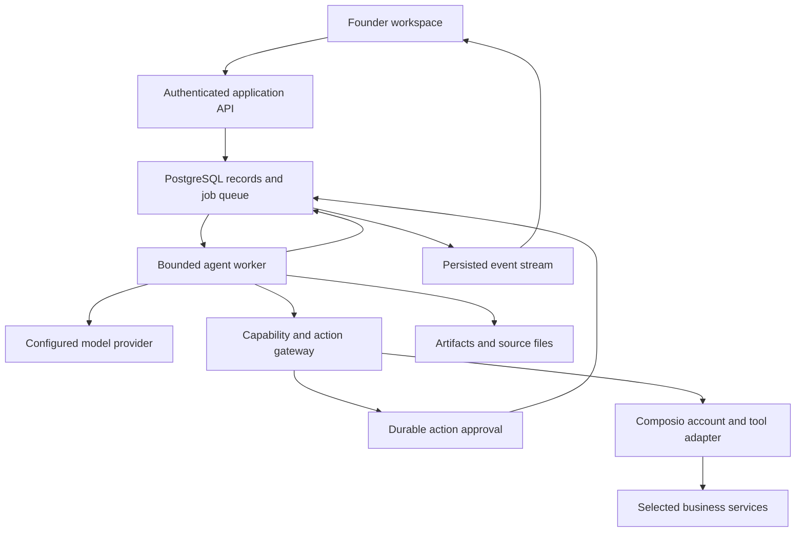

# Bootstrap technical design

Version: 0.1 proposal. All stack choices and limits below are implementation recommendations. No live service has been provisioned by this specification change.

## 1. Architecture

Use a TypeScript monorepo with a web application and a separate long-lived worker. PostgreSQL stores business data, execution state, and the job queue. The web request accepts work and streams events; the worker executes it independently of a browser connection.

The application gateway is the only execution path for tools. Internal tools also use authorization and structured validation. Provider-managed tool execution must not bypass the gateway.

### Proposed stack

| Layer | Choice | Purpose and boundary |
| --- | --- | --- |
| Web | Next.js, React, TypeScript | Founder application and authenticated API; deployable as a Node container |
| UI | Selected AffectUI/BeUI source, Tailwind, Bootstrap wrappers | Shared tokens and controlled product components |
| Model interface | Vercel AI SDK | Streaming, structured outputs, provider adapters; Bootstrap owns durable steps and policy |
| Database | PostgreSQL with Drizzle migrations | Tenant-scoped records, concurrency control, full-text retrieval |
| Durable jobs | pg-boss | Postgres-backed scheduling, retries, and workers; action ledger still required |
| Authentication | Better Auth with database-backed sessions | Initial owner authentication; signup closed after owner bootstrap in self-host mode |
| Integrations | Composio server SDK behind an adapter | Connections, scoped tool discovery, execution, account status |
| File storage | Local volume adapter and S3-compatible adapter | Private sources and artifacts, authorized downloads |
| Live updates | Server-sent events | Ordered run updates with cursor-based reconnect |
| Tests | Vitest and Playwright | State/policy contracts, recovery integration tests, product acceptance |
| Packaging | pnpm workspace and Docker Compose | Reproducible development and self-host deployment |

AI SDK documents loop controls; pg-boss documents transactional job creation, scheduling, and retries; Better Auth documents PostgreSQL/Drizzle integration. Those capabilities support this selection, but do not by themselves implement Bootstrap's recovery, authorization, or tenancy. See [source notes](sources.md). Pin supported, tested package versions during the foundation milestone; do not copy API names from an older SDK example without checking the installed version.

Do not add a second orchestration framework, Redis, a separate vector database, or Kubernetes in the initial deployment. Revisit these only for measured scaling or workflow needs. A Postgres queue does not guarantee exactly-once external effects.

## 2. Repository boundaries

| Proposed path | Responsibility |
| --- | --- |
| `apps/web` | Routes, API handlers, authenticated SSE, founder UI |
| `apps/worker` | Job processing, execution leases, scheduled work, reconciliation |
| `packages/domain` | IDs, state transitions, task/output contracts, validation |
| `packages/agent-runtime` | Bounded model steps, context, delegation, cancellation |
| `packages/integrations` | Composio adapter and validated capability manifests |
| `packages/policy` | Grants, resource restrictions, approval decisions, spend reservation |
| `packages/db` | Schema, migrations, transactions, scoped query helpers |
| `packages/ui` | Approved components, tokens, controlled adapters, provenance |
| `packages/storage` | Local/S3 file interfaces and retention operations |
| `packages/evals` | Seeded business tasks, expected evidence, failure fixtures |
| `deploy` | Compose, environment example, migration and backup instructions |

These are logical modules, not independently deployed microservices. Keep cross-module contracts explicit and start with the smallest useful files.

## 3. Domain data model

Use opaque IDs. Tenant-owned tables include `workspace_id`, timestamps, and appropriate version columns. Foreign keys involving tenant-owned objects include the workspace boundary so an ID from another business cannot be attached accidentally.

| Record | Important fields and relationships |
| --- | --- |
| Workspace / Membership | Owner, name, timezone, locale, settings; one active owner membership in initial UI |
| BusinessProfileVersion | Workspace, version, content, approved facts, author, source references |
| Agent / AgentVersion | Role, instructions, output contract, model profile, immutable configuration version |
| Connection | Workspace, member, Composio principal, toolkit, connected-account ID, actual account identity, auth-config ID, status |
| CapabilityGrant | Agent, connection, capability, resources, constraints, expiry, policy version, revocation |
| Goal / Task | Objective, criteria, owner agent, state, due date, goal, dependency IDs, latest accepted output |
| Conversation / Message | Workspace, thread, role, content parts, task links, message idempotency key |
| Run / RunStep | Task, root/parent run, agent version, status, checkpoint, lease epoch, limits, source snapshots |
| RunEvent | Run, monotonic sequence, event kind, sanitized payload, timestamp |
| Artifact / ArtifactVersion | Task, content or private storage key, type, source citations, author, review state, content hash |
| Action / ActionAttempt | Capability, connection, target, canonical payload hash, state, operation key, provider receipt, uncertainty |
| Approval | Action revision/hash, authorized actor, exact decision, expiry, permission snapshot, consumed state |
| KnowledgeSource / SourceVersion | Type, remote reference or file, content hash, access scope, freshness, ingest state |
| Routine / RoutineOccurrence | Task template, timezone, schedule, enabled state, occurrence key, run, source checkpoints |
| UsageEntry / BudgetReservation | Root run, agent, model/tool, tokens or charge units, known/estimated amount, reserved/settled state |
| AuditEvent / OutboxEvent | Actor, object, transition, redacted evidence; durable event dispatch |

Enforce unique keys for `(workspace_id, client_request_key)`, routine occurrence, run event sequence, logical action operation, and approval decision. Model-produced IDs, workspace IDs, and connection IDs are never trusted without server resolution.

## 4. State and execution contracts

Keep these states independent:

- Task: `todo`, `in_progress`, `needs_review`, `blocked`, `done`, `cancelled`.
- Run: `queued`, `running`, `waiting_input`, `waiting_approval`, `waiting_service`, `paused_budget`, `reconciling`, `succeeded`, `failed`, `cancelled`.
- Action: `proposed`, `awaiting_approval`, `authorized`, `dispatching`, `verifying`, `succeeded`, `failed`, `outcome_unknown`, `rejected`, `expired`, `superseded`.

A run can succeed by producing an artifact that still needs founder acceptance. A task becomes done only when its completion criteria are satisfied by an accepted output or verified action. Provider acceptance of a send request does not establish that the recipient received or read the message.

Each run step checkpoints its inputs, configuration versions, output references, usage, and next state. Pausing for approval or service recovery releases the worker; it does not hold an HTTP request or sleep a process indefinitely. A new job resumes from the persisted checkpoint.

Workers use leases and fencing epochs to prevent stale attempts from advancing a run. Check cancellation, grants, and lease ownership immediately before every tool dispatch. Already dispatched requests can outlive cancellation; record their eventual results and do not claim cancellation reversed them.

### Proposed initial limits

| Limit | Initial default for evaluation |
| --- | --- |
| Delegation depth | 1: coordinator to specialist |
| Specialist assignments | 3 per root task |
| Concurrent active model steps | 2 per workspace |
| Model steps | 24 total across parent and children |
| Tool invocations | 40 total across parent and children |
| Active execution time | 10 minutes; approval/service waiting time tracked separately |
| Repeated no-progress attempts | 3 equivalent attempts, then a blocked result |
| Approval expiry | 24 hours, or earlier if the underlying action/resource changes |
| Spend | Founder-configured per-run and workspace limits; no unlimited default |

These are tuning parameters for the reference workflows. Count retries, children, and synthesis against the same root limits. A limit preserves completed outputs and reports remaining work. A human can authorize a new bounded attempt rather than silently resetting counters.

## 5. Composio integration

### Ownership and account model

Keep three concepts separate: an auth configuration describes an application's authentication setup; a connected account represents a person's authenticated service account; a runtime session scopes an execution context. Bootstrap stores stable IDs and readable account identity, not OAuth tokens in prompts.

Create an opaque Composio principal for each workspace/member pair. A user's two businesses therefore do not silently share external identities. Keep deployment API keys and auth configuration references server-side. Each self-host operator uses its own Composio project and model credentials.

Tool Router documentation states that account selection is live when no account override is supplied, while explicit account pins prevent fallback for the toolkit. Bootstrap pins the selected account and a positive toolkit/capability allowlist for each run. Session deletion is separate from account revocation. SDK/API field shapes must match the pinned version; [source notes](sources.md) records the current documents.

### Connection lifecycle

1. An authenticated founder selects a service and intended use.
2. The server checks the selected deployment auth configuration and initiates an authorized connection flow with a short-lived state binding to workspace and member.
3. The browser completes consent. A redirect alone does not establish success.
4. The server verifies connection status, principal ownership, actual account identity, and granted scopes; it performs a bounded read test where supported.
5. The founder assigns explicit capabilities and resources to agents.
6. Every run resolves the selected connection again before use. Revocation, expiry, or account mismatch blocks that capability.

For public multi-account deployment, enable Composio's callback identity verification and redeem the returned session through the authenticated server using the expected principal. This is separate from merely checking an account ID on redirect and prevents a connection link completed by the wrong browser identity from becoming usable. Confirm the selected SDK's current flow during implementation; [connected-account documentation](https://docs.composio.dev/reference/api-reference/connected-accounts) describes the capability.

Reconnect creates or verifies a connection binding; it cannot silently retarget a queued action to another account. Disconnect revokes local grants immediately, invalidates affected pending actions/sessions, disables relevant routines, and uses the provider/Composio revocation operation when supported. Keep historical receipts with access controls and retention rules.

### Tool gateway

Expose typed Bootstrap capabilities, backed by a reviewed manifest. Manifest fields include capability ID, provider tool slug/version, input schema, effect class, required OAuth scopes, resource constraints, approval behavior, timeout, safe retry policy, output redaction, receipt extraction, and verification strategy.

Do not expose a general execute-tool, authenticated proxy, remote shell, or batch-execution capability to the model in v0.1. Discovery can identify candidates, but does not grant execution. If a future Tool Router interface is used, inspect and authorize every underlying action, including nested batches. Top-level approval of an opaque execution wrapper is insufficient.

Permission is the intersection of workspace policy, current agent grants, the assignment's authority, connection ownership, allowed resources, and action approval. Tool descriptions and remote document instructions cannot widen it. Unknown tools or malformed inputs are rejected.

Resource restrictions must constrain the provider request, not only filter the result afterward. If a tool cannot enforce the selected repository/page/thread boundary, use a narrower capability or do not enable it. OAuth consent may be broader than an agent's allowed use.

### Initial tested action set

The identifiers below are Bootstrap capability names, not asserted Composio tool slugs. Resolve actual supported tools and schemas during integration work.

| Service | Initial capabilities | Review behavior |
| --- | --- | --- |
| Gmail | Search/read permitted threads; prepare an internal draft; send an exact reviewed message | Reads follow explicit source grants; sends require exact approval or a narrow standing grant |
| Google Calendar | List/read selected calendars and event details | Read only in v0.1; event creation/invitations later |
| Notion | Read selected pages/data-source records; create a page; enable reviewed updates only after validating the required provider conflict semantics | Writes show exact parent/record and content/diff |
| GitHub | Read selected repository issues/PR metadata; create an issue | Issue creation shows repository/title/body; code pushes/merges/deployments later |

An internal draft is stored in Bootstrap. Creating a draft inside an external email account is itself an external write and needs classification. Keep this distinction explicit in both tool names and UI.

Composio-managed built-in paid capabilities, instant access, model-driven connection management/removal, and any sandbox features remain disabled unless separately included in a reviewed capability. Founder-initiated connection management remains available through the authenticated product API. A platform's availability defaults are not Bootstrap's authorization defaults.

### Events and routines

Scheduled routines use the application scheduler in v0.1. Broad event-triggered automations are deferred. Any connection-lifecycle or future trigger webhook uses the official signature verification path with the raw request, a signing secret, and replay/timestamp checks. A parser without signature verification is insufficient.

Persist a verified event and its deduplication key before acknowledging it; execute asynchronously. Match principal, connection, subscription, and workspace server-side. Treat event payloads as untrusted business input. Prevent feedback loops when Bootstrap's own write generates another event.

## 6. Action approvals and uncertain outcomes

An action preview includes the exact account, operation, destination, body/diff, attachments and hashes, expected effect, relevant remote precondition/version, and estimated cost where known. Serialize its canonical payload and store a hash.

Approval records that action revision/hash, the founder or standing-policy identity, policy version, and expiry. Material edits supersede the approval. The approval endpoint validates current ownership and changes state atomically. Repeated clicks return the existing decision.

In one transaction, consume approval, reserve the unique operation, and enqueue dispatch. At execution, revalidate current grants, action revision, connection identity, cancellation, and remote preconditions. Only the lease owner dispatches. Never hold a database transaction open across a provider call.

Revalidate approval expiry, the approving actor's current authority, and the applicable policy revision immediately before dispatch, including after queue delay or service recovery. Consuming an approval records the decision; it does not extend its validity. Expired or materially changed authorization returns the action for review without dispatch.

The capability manifest declares whether the provider/tool supports atomic conditional writes. For reviewed updates, enforce the expected remote version inside the write request where supported. A preceding read is not equivalent. Keep stale-sensitive overwrites disabled when the required atomic protection is unavailable; do not promise stale-update rejection for an unconditional write.

Persist the dispatch intention before the external call, then save the response and verify the resulting state where supported. Use provider idempotency keys only where documented. A request can succeed remotely and fail before the local receipt is stored; no local database transaction removes that uncertainty.

Allocate the logical operation key once and retain it through all attempts, retries, and worker takeovers. A non-idempotent action left in dispatching enters reconciliation after lease loss. A replacement worker must not send it again merely because the run lease expired. A committed dispatch intention without a conclusive receipt is potentially sent, even if the old worker may have crashed before making the network call.

| Failure case | Behavior |
| --- | --- |
| Safe read or confirmed pre-dispatch failure | Bounded retry with backoff/jitter, respecting rate limits |
| Unsupported/invalid payload or permission denial | Do not retry unchanged; expose a specific remedy |
| Provider rate limit | Respect retry information and account-level concurrency; park the run |
| Write with documented idempotency key | Retry only under that provider contract with the same key |
| Write timeout/crash after dispatch without reliable deduplication | Mark outcome unknown; reconcile by receipt/resource lookup or request verification |
| Remote resource changed since review | Supersede action; show the updated proposal for authorization |

For an ambiguous send, absence from a quick search is not sufficient proof it failed. Keep it unresolved when reliable confirmation is unavailable. A later compensating action, such as editing a created page, is a new action with its own policy; do not present it as transactional rollback.

## 7. Knowledge and context

Separate founder-approved business facts, selected source documents, task working context, and optional agent-specific notes. Every durable fact retains provenance, version, timestamp, and scope. Agents propose profile changes; founders can accept, edit, or reject them.

Initially ingest text, Markdown, and text-bearing PDF uploads, plus explicitly selected Notion/GitHub content. Reject unsupported/encrypted files clearly; OCR and crawling entire accounts are later work. Bound file size, parsing time, retrieved document count, and model context. Suggested initial limits are 20 MiB per upload and an explicitly configured per-run retrieval/token budget, subject to evaluation.

Use full-text retrieval first; add pgvector when benchmarked questions show value. Retrieval enforces workspace/agent grants before ranking and before returning snippets. Citations identify source, version, remote link, and relevant passage. Store source freshness and surface incomplete coverage.

Cached sources retain their originating connection, resource, and access binding. Before retrieval for a new run, validate local grants and connection status and perform the supported upstream-access check for the resource. If access cannot be verified, block that source and expose a coverage gap rather than silently serving cached content. Recheck at subsequent retrieval boundaries; do not imply access can be recalled from a model call already in flight. Revocation invalidates affected caches. Historical artifacts follow current artifact access and retention rules and do not automatically become a route to reuse revoked source content in new agent context.

Prompt injection in email, documents, and tool responses cannot change permissions, grant tools, or authorize a new destination. Retrieved text is data. Redact secrets and unnecessary personal data from model inputs, logs, and diagnostics. Use safe URL handling and SSRF protection for any future URL importer.

Removal immediately removes a source from retrieval, tombstones derived chunks, and schedules private-file cleanup once references are resolved. Retained historical artifacts are identified separately; removing a source does not silently rewrite history. Workspace deletion/export and retention behavior must be documented.

## 8. API contract outline

Use authenticated, workspace-scoped endpoints with typed request/response schemas. Creation accepts an idempotency key; edits accept a version precondition. Lists use cursors. Mutations return a durable object ID and current state, not a claim of future external success.

| Endpoint | Contract |
| --- | --- |
| `POST /api/workspaces` | Create workspace and owner membership |
| `POST /api/w/:wid/agents` | Create versioned role and explicit grants |
| `POST /api/w/:wid/conversations/:id/messages` | Persist message; return message/task/run IDs where work is created |
| `POST /api/w/:wid/tasks` | Objective, output contract, criteria, agent, resource references |
| `POST /api/w/:wid/tasks/:id/runs` | Start a bounded attempt using validated configuration |
| `GET /api/w/:wid/runs/:id/events` | SSE with monotonic event IDs and authenticated reconnect cursor |
| `POST /api/w/:wid/runs/:id/cancel` | Persist cancellation and propagate to children |
| `POST /api/w/:wid/connections/start` | Start consent for a server-resolved toolkit and principal |
| `POST /api/w/:wid/approvals/:id/decision` | Approve/reject exact action revision and payload hash |
| `POST /api/w/:wid/artifacts/:id/versions` | Save founder edits with version precondition |
| `POST /api/w/:wid/routines` | Schedule, timezone, template, scope, limits |
| `POST /api/webhooks/composio` | Verified, deduplicated ingress only; no direct synchronous agent run |

All IDs are validated against the authenticated workspace. SSE and artifact downloads enforce the same rules as normal API reads. Event names include `run.queued`, `step.started`, `artifact.created`, `approval.required`, `action.dispatched`, `action.outcome_unknown`, and `run.completed`; version event payloads for compatibility.

## 9. Security, budgets, and observability

Use secure database-backed sessions, CSRF protection for browser mutations, origin validation for OAuth, encrypted server-held credentials, redacted logs, and separate development/production keys. Keep model and Composio credentials out of browser bundles and repository files. Treat generated files and remote content as untrusted.

Every internal query must be tenant-scoped. Add PostgreSQL row-level policies where practical and test with the actual application database role; privileged worker roles must still validate workspace ownership. Include adversarial cross-workspace ID tests for files, SSE, approvals, and connectors.

Reserve a conservative maximum estimated model cost before each call; include all children and retries in the same budget ledger. Reconcile tokens and known charges afterward. Also enforce output-token, step, tool-call, and time caps. Unknown tool pricing is visible and requires explicit configuration rather than being counted as zero. Spend limits constrain new dispatch; third-party billing can settle later and estimates are not a guarantee of exact invoiced cost.

Record task/run/step correlation IDs, tool latency, result classification, connection failures, queue lag, budget stops, and reconciliation backlog. Store sanitized execution summaries and receipts; do not store private chain-of-thought. Keep optional telemetry content-free and off by default for self-hosting.

## 10. Scheduling and deployment

Store timezone as an IANA identifier and occurrence times in UTC. For daylight-saving transitions, run once at the first valid occurrence of a duplicated local time; skip a nonexistent time and record it. On downtime, coalesce a missed briefing into one catch-up run with an explicit covered period. Do not replay a backlog of external writes automatically. Source-specific successful checkpoints determine incremental coverage.

The initial deployment uses web, worker, PostgreSQL, and a private artifact volume. S3-compatible storage is optional through the adapter. Expose HTTPS for browser use and OAuth callbacks; public webhook ingress is necessary only when that feature is enabled. Reverse proxies must support SSE without buffering long updates.

Publish an environment example containing variable names, never secrets: database URL, authentication secret/base URL, Composio key and auth-config IDs, model credentials, credential-encryption key, storage settings, and optional webhook signing secret. Docker images and migrations are versioned. Startup health distinguishes web readiness, database migration state, worker heartbeat, and connector readiness.

Back up database, artifact storage, and the required encryption-key material through an operator-controlled process. Test restore into an isolated environment with dispatch disabled. Reconcile any previously dispatching actions before enabling writes after restoration. Production backups and restore evidence are part of release operations, not inferred from a successful database dump.

## 11. Proposed quality targets

These are acceptance targets, not measured performance claims: API acknowledgment p95 below 500 ms for local persistence under the documented pilot load; persisted progress visible within 2 seconds; reconnection restores visible run history within 5 seconds on a healthy deployment. External provider latency is reported separately. The initial load scenario is ten workspaces with two active model steps each, using fake providers for deterministic load testing and bounded live smoke tests.

Correctness gates take priority: no cross-workspace access, unauthorized tool dispatch, stale approval use, or duplicate external effect in the defined fault-injection scenarios. See [implementation plan](implementation-plan.md) for the concrete release suite.
